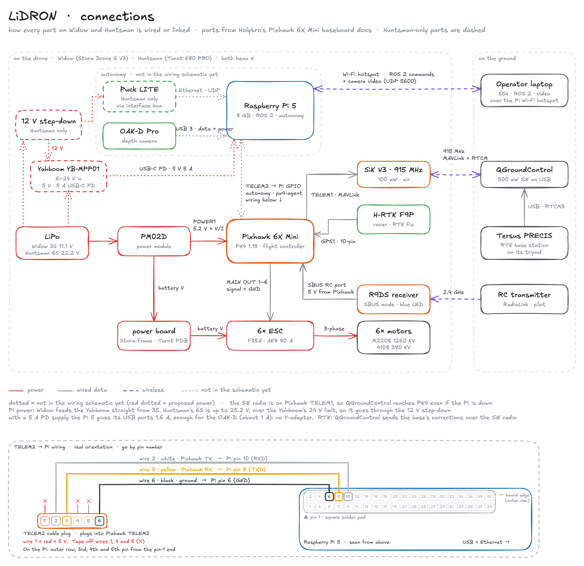

# Drone Construction

LiDRON's drone models and the parts we 3D print for them. Two drones: Widow (test drone) and Huntsman (carries the LiDAR).

## How everything connects

Both drones, power, data and radio, plus the ground station with the RTK base. Dashed boxes are Huntsman only.

<picture>
  <source media="(prefers-color-scheme: dark)" srcset="docs/architecture/connections-dark.png">
  
</picture>

The Pi gets its power from a Yahboom YB-MPP01 board (6 to 24 V in, 5 V / 5 A USB-C PD out). Widow feeds it straight from its 3S. Huntsman's 6S goes up to 25.2 V, over the board's 24 V limit, so on Huntsman it hangs off the 12 V step-down. That step-down also powers the LiDAR and is rated 3 A, so measure the current on the bench before flying. Neither CAD model has the board yet (it is 65 x 56 mm, 32 g).

Edit the diagram by opening `docs/architecture/connections.excalidraw` at [excalidraw.com](https://excalidraw.com).

## Before each drone flies

- Airframe: Generic Hexarotor x (6001) on both. The camera, Pixhawk arrow and GPS arrow all point out of the gap between arms 1 and 2. Run the motor test in QGroundControl's Actuators tab after any change, then recalibrate the compass.
- `MPC_XY_VEL_MAX` 2.2352 (5 mph) and `COM_OBL_RC_ACT` 4 (land if the autonomy stops sending), see [pi-setup.md](https://github.com/LiDRON7/Sensor-Control-Data-Gathering/blob/main/docs/pi-setup.md).
- Motor thrust has never been measured on either drone ([#35](https://github.com/LiDRON7/Drone-Construction/issues/35)). The simulator's thrust is a guess, so check hover throttle on the first manual flight (under 65 %).
- Weigh the drone with everything on and compare it with the README's total.

## Widow

Storm Drone 6 V3. Parts, sizes and weights: [Widow README](3D%20Models/Widow/README.md).

 

| Picture | Part | Print | What it does |
|---|---|---|---|
|  | [Landing Leg](3D%20Models/Widow/Printed%20Parts/Landing%20Leg) | 1 mount, 2 feet | Holds both legs, the battery and the camera |
|  | [Propeller Guard](3D%20Models/Widow/Printed%20Parts/Propeller%20Guard) | 6 | One per prop, held by the motor screws |

## Huntsman

Tarot 680 PRO with the Velodyne Puck LITE. Parts, sizes, weights and LiDAR wiring: [Huntsman README](3D%20Models/Huntsman/README.md).


 

| Picture | Part | Print | What it does |
|---|---|---|---|
|  | [Payload Carrier](3D%20Models/Huntsman/Printed%20Parts/Payload%20Carrier) | 1 carrier, 1 interface-box plate, 1 LiDAR strap, 6 rod clamps | Hangs under the frame and holds the LiDAR, battery, camera and LiDAR interface box |
|  | [Propeller Guard](3D%20Models/Huntsman/Printed%20Parts/Propeller%20Guard) | 6 guards (2 halves each) | One per 13" prop, held under the motor by its screws |

We print on a Bambu Lab X2D (bed 256 x 256 mm). Propeller guards are PETG; Huntsman's payload carrier, rod clamps and LiDAR strap are PAHT-CF
(dry it first); everything else is PETG-CF. Use PLA only
for test prints.

## Print a part

Open the part's folder and pick a file:

- `.gcode.3mf` is sliced for the X2D: open it in Bambu Studio (or send it from Bambu Handy) and print. Pick the
  AMS slot with the right filament when it asks.
- `.stl` is for any other printer (click it on GitHub to spin it in 3D)
- `.step` opens in Fusion or any CAD program

## Upload a new or changed file

1. Open the folder the file belongs in.
2. Click Add file, then Upload files, and drag your files in.
3. Write one line about what changed, then click Commit changes.

Keep the same file name when you change a part. No `v2`, no `final`, no "old" folders. GitHub keeps every earlier version: open the file, click History, pick the change.

## Where things are

```
3D Models/
├── Widow/
│   ├── Printed Parts/     parts we print
│   ├── Reference Parts/   models of parts we buy, to design holders around
│   └── Full Drone/        everything put together
├── Huntsman/              same folders (Reference Parts has the Tarot 680 PRO frame)
└── Fusion Scripts/        the scripts that build the models
```

Reference parts start with their kind so they sort together: `frame-`, `propulsion-`, `power-`, `flight-controller-`,
`gps-`, `radio-`, `computer-`, `camera-`, `misc-`. Anything named `placeholder` is a rough block until we measure it.

## Change a part's size

Each part has a script in `Fusion Scripts` (`landing_leg.py` builds Widow's landing leg, `huntsman_*.py` build
Huntsman's parts). Sizes are at the top of each script. With Fusion open and the
[Fusion360MCP add-in](https://github.com/faust-machines/fusion360-mcp-server) running:

```
cd "3D Models/Fusion Scripts"
python3 run_in_fusion.py execute_code -code landing_leg.py
```

The scripts check strength and fit and stop with a message if something is off. Then run `full_drone.py` (or
`huntsman_full_drone.py`) so the whole drone picks up the change.

Stuck? Ask Alex or Devlin.
